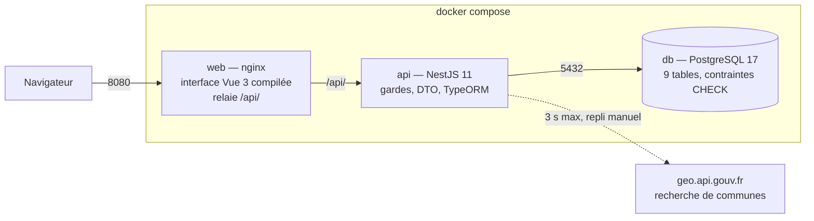

# Re-Tired Hearts

Service fictif de **Happy Retired** : une plateforme qui aide les personnes de plus de 60 ans à
rencontrer des gens partageant leurs centres d'intérêt, puis à se retrouver lors d'activités locales.

Projet pédagogique Holberton — **NestJS + Vue.js + PostgreSQL**.


> **État : MVP livré.** Comptes et profils modérés, découverte des membres, sorties avec inscription,
> messagerie privée entre participants, back-office de modération, recherche de communes, pages vie
> privée et mentions légales. Toutes les données de démonstration sont fictives.

## Ce que permet l'application

| Pour qui | Parcours |
|---|---|
| Visiteur | Accueil, centres d'intérêt, inscription, connexion, vie privée, mentions légales |
| Membre (profil en attente) | Compléter son profil (ville via la recherche de communes, centres d'intérêt), consulter les sorties |
| Membre approuvé | Découvrir les membres (filtres centre d'intérêt et département), s'inscrire à une sortie et s'en désinscrire, voir l'adresse exacte une fois inscrit, écrire aux participants d'une même sortie ou à l'organisateur |
| Organisateur | Créer une sortie (brouillon), la modifier, la publier, l'annuler avec un motif, la clôturer ; retrouver toutes ses sorties dans « Mes sorties » |
| Modérateur | Files des profils, des comptes et des sorties : approuver, bloquer, suspendre, réactiver, changer le rôle, annuler une sortie ; chaque décision est journalisée. Aucun accès aux messages |

Les règles détaillées (statuts, visibilité, capacité, éligibilité des conversations) sont dans
[docs/regles-metier.md](docs/regles-metier.md).

## API

L'API NestJS expose ses routes sous `/api` : santé et centres d'intérêt, comptes et profils,
découverte des membres, sorties et inscriptions, conversations et messages, modération, et recherche
de communes. La liste détaillée des routes, permissions, formats de réponse et erreurs est décrite
dans [docs/contrats-api.md](docs/contrats-api.md) ; les routes déjà implémentées sont également
consultables dans Swagger sur `/api/docs`.

Les sessions utilisent un cookie `httpOnly`, `SameSite=Strict`, valable deux heures et `Secure` en
production. L'API vérifie les statuts, rôles et droits sur chaque ressource ; les DTO valident les
entrées et rejettent les champs inconnus. Les erreurs renvoyées suivent un format JSON commun et les
routes sensibles sont limitées en débit. Le navigateur ne se connecte jamais directement à PostgreSQL ;
seule l'API appelle le service externe de recherche de communes, avec un délai maximal de trois secondes
et une saisie manuelle de secours en cas d'indisponibilité.

## Mécanismes implémentés

Les parcours ci-dessus reposent sur quelques mécanismes qu'un relecteur voudra regarder de près.
Les règles citées (`R-…`) sont détaillées dans [docs/regles-metier.md](docs/regles-metier.md), les
codes d'erreur dans [docs/contrats-api.md](docs/contrats-api.md).

**Sorties — cycle de vie et propriété** (`api/src/events/events.service.ts`)
`draft` → `published` → `cancelled` ou `completed`. Chaque transition est vérifiée côté serveur et
refusée par `409 INVALID_EVENT_TRANSITION` quand elle n'a pas de sens : publier autre chose qu'un
brouillon, annuler ce qui n'est pas publié, clôturer avant la fin de la sortie
(`409 EVENT_NOT_FINISHED`). Seul un brouillon sans inscription est supprimable
(`409 EVENT_NOT_DELETABLE`), une sortie publiée doit rester à venir (`409 EVENT_IN_PAST`), et la
date, le lieu et le centre d'intérêt se figent dès la première inscription
(`409 EVENT_HAS_REGISTRATIONS`). La propriété est relue en base à chaque écriture : avoir le rôle
d'organisateur ne suffit pas, il faut être celui de *cette* sortie (`403 NOT_EVENT_OWNER`).

**Inscriptions — capacité tenue sous concurrence** (`api/src/events/registrations.service.ts`)
Une inscription prend un verrou d'écriture sur la ligne de la sortie (`SELECT … FOR UPDATE`,
`api/src/events/lock-event.ts`) **avant** de compter les places, dans une transaction
`READ COMMITTED`. Deux demandes simultanées sur la dernière place sont donc servies l'une après
l'autre : la seconde reçoit `409 EVENT_FULL` et aucune ligne n'est écrite. Le même verrou protège la
baisse de capacité par l'organisateur (`409 CAPACITY_BELOW_REGISTRATIONS`) et le script de seed. Une
désinscription repasse la ligne en `withdrawn` plutôt que de la supprimer, ce qui libère la place et
garde la trace ; une réinscription réutilise la même ligne.

**Adresse exacte et participants** (R-LOC-4)
L'adresse exacte n'est renvoyée qu'à l'organisateur, aux inscrits et aux modérateurs ; pour tous les
autres le champ vaut `null` et la fiche ne montre qu'un repère public, la ville et le département.
Les réponses sont construites par liste blanche de champs, jamais par recopie de l'entité, pour
qu'aucun code postal ou code INSEE ne fuite par inadvertance.

**Messagerie — éligibilité, confidentialité, pagination** (`api/src/messaging/`)
Démarrer une conversation exige une **sortie commune** : les deux `registered` au même événement, ou
l'un inscrit à l'événement organisé par l'autre (R-MSG-1). La vérification tient en une requête SQL ;
sans sortie commune, `403 NOT_ELIGIBLE`. S'y ajoutent les deux comptes actifs, les deux profils
approuvés et le consentement des deux (`409 MESSAGING_DISABLED`) ; une inscription retirée ne donne
aucun droit de contact. La paire est stockée ordonnée (`participant_a_id < participant_b_id`) avec une
contrainte unique, donc (A, B) et (B, A) sont la même conversation. La confidentialité est tenue par
une garde qui s'exécute **avant** les pipes de validation Nest : un tiers reçoit
`404 CONVERSATION_NOT_FOUND` sans que le corps de son message soit même analysé, et un modérateur n'y
a pas plus accès qu'un autre (R-MSG-4). L'historique est paginé par curseur `(created_at, id)` ; un
curseur étranger à la conversation est refusé en `400` au lieu de renvoyer une page vide.

**Recherche de communes — service externe et repli** (`api/src/cities/cities.service.ts`)
`GET /api/cities?q=` interroge `geo.api.gouv.fr`, communes les plus peuplées d'abord, huit résultats
au plus. Trois protections : un délai maximal de **3 secondes** (`AbortController`), une validation
stricte de chaque champ de la réponse — nom, code INSEE, code département, codes postaux — une
réponse mal formée étant traitée comme une panne, et un cache mémoire de 10 minutes limité à
100 entrées, évincé en LRU. Toute panne devient un seul `503 CITY_LOOKUP_UNAVAILABLE`, sans laisser
filtrer le message d'origine, et l'interface bascule en saisie manuelle : la ville reste renseignable,
`cityCode` passe à `null` et `locationVerified` à `false` (R-LOC-3).

**Limitation de débit** (`api/src/common/account-throttler.guard.ts`)
Par compte quand la requête est authentifiée, par adresse IP sinon (`TRUST_PROXY_HOPS` pour nginx) :
inscription 10 par heure, connexion 5 par quart d'heure, recherche de communes 30 par tranche de
10 secondes, envoi de messages 30 par 10 minutes. Dépassement → `429`.

## Documentation

| Document | Contenu |
|---|---|
| [docs/equipe-et-perimetre.md](docs/equipe-et-perimetre.md) | Équipe, planning, périmètre du MVP, exclusions, conventions Git |
| [docs/modele-donnees.md](docs/modele-donnees.md) | Les 9 entités, le diagramme, les relations et les contraintes |
| [docs/regles-metier.md](docs/regles-metier.md) | Rôles, statuts, confidentialité, capacité, cycle de vie, éligibilité des conversations |
| [docs/contrats-api.md](docs/contrats-api.md) | Routes, entrées, sorties, permissions et erreurs de tout le MVP |
| [docs/architecture.md](docs/architecture.md) | Choix techniques, organisation du code, API externe, tests, **registre des risques** |

## Structure du dépôt

```
api/     API NestJS (TypeScript, TypeORM, PostgreSQL)
web/     Interface Vue 3 (Vite)
docs/    Documentation de conception
docker/  Script d'initialisation PostgreSQL (création de la base de test)
```

## Architecture

Trois conteneurs, un seul point d'entrée public. Le navigateur ne parle qu'à nginx, qui sert
l'interface compilée et relaie `/api/`. L'API est seule à joindre PostgreSQL et seule à sortir vers
le service de recherche de communes.



| Module de l'API | Rôle |
|---|---|
| `auth` | Hachage Argon2id, cookie de session, gardes et décorateurs d'autorisation |
| `profiles` (+ `users`) | Profils, statuts, découverte des membres approuvés |
| `events` | Sorties, cycle de vie, inscriptions, participants, filtres |
| `messaging` | Éligibilité, conversations, messages |
| `moderation` | Files de modération et journal d'audit |
| `cities` | Recherche de communes et repli manuel |
| `interests`, `health` | Référentiel des centres d'intérêt, sonde de santé de Compose |
| `common`, `config` | Format d'erreur commun, validation, limitation de débit, variables d'environnement |
| `database` | Migrations versionnées et script de données de démonstration |

Les choix techniques, le détail des couches et le **registre des risques** sont dans
[docs/architecture.md](docs/architecture.md) ; les 9 entités et leurs contraintes dans
[docs/modele-donnees.md](docs/modele-donnees.md).

## Prérequis

- Docker Desktop (ou Docker Engine) avec Docker Compose v2
- Pour travailler hors conteneur : Node.js 22 LTS et npm 10+

## Démarrage rapide (tout en conteneurs)

```bash
cp .env.example .env              # puis remplacer DATABASE_PASSWORD et JWT_SECRET
docker compose up --build -d
docker compose run --rm -e ALLOW_DEMO_SEED=true api npm run seed:prod   # données de démonstration
```

Ouvrir ensuite <http://localhost:8080> et se connecter avec un
[compte de démonstration](#données-de-démonstration-issues-7-et-30).

| Service | URL | Remarque |
|---|---|---|
| Interface Vue | <http://localhost:8080> | nginx sert l'application et transmet `/api` |
| API NestJS | <http://localhost:3000/api> | |
| Documentation OpenAPI | <http://localhost:3000/api/docs> | Routes implémentées |
| Santé de l'API | <http://localhost:3000/api/health> | Utilisée par la sonde Compose |
| PostgreSQL | `localhost:5442` | Port modifiable via `DATABASE_PORT` |

**Ordre de démarrage :** `db` doit être déclaré sain (`pg_isready`) avant que `api` ne démarre ;
l'API joue alors les migrations puis se lance. `web` attend que l'API réponde sur `/api/health`.
Les trois services sont donc liés par `depends_on: condition: service_healthy`, pas par un simple
ordre de lancement.

## Parcours de démonstration

Ce parcours traverse les quatre rôles et montre les règles à l'œuvre. Tous les comptes fictifs
utilisent le mot de passe `ReTiredDemo2026!`.

1. **Visiteur** — <http://localhost:8080> : l'accueil liste les centres d'intérêt lus en base. « Vos
   données et votre vie privée » et les mentions légales sont accessibles sans compte.
2. **Créer un compte** — « Inscription ». Le profil part en attente de modération (R-PROF-1). Dans
   « Mon profil », chercher sa ville — la saisie interroge `geo.api.gouv.fr` — et cocher des centres
   d'intérêt. « Les membres » reste refusé, et l'écran dit pourquoi au lieu d'une page vide.
3. **Modérateur** — `moderateur@example.test` : « Modération → Profils », file « en attente ». Le
   profil créé y est ; l'approuver. La décision est écrite dans le journal d'audit.
4. **Membre approuvé** — se reconnecter avec le compte créé : « Les membres » s'ouvre, filtrable par
   centre d'intérêt et par département.
5. **Organisateur** — `organisateur@example.test` : « Mes sorties » liste ses sorties. En créer une,
   qui naît en brouillon, puis la publier. Elle ne pourra plus revenir en brouillon.
6. **S'inscrire** — avec `membre1@example.test`, ouvrir une sortie et s'inscrire : **l'adresse exacte
   n'apparaît qu'à partir de maintenant**. Se désinscrire libère la place aussitôt.
7. **Messagerie** — toujours avec `membre1@example.test`, ouvrir la fiche de `membre2@example.test` et
   cliquer « Écrire » : les deux sont inscrits à la même sortie, le contact est donc permis. Depuis le
   compte créé à l'étape 2, le même bouton répond que la conversation sera possible après une sortie
   commune (`403 NOT_ELIGIBLE`).
8. **Annuler** — depuis l'organisateur, annuler la sortie avec un motif de 5 à 300 caractères, que
   les inscrits verront. L'annulation est définitive : seul un brouillon peut être publié, donc une
   sortie annulée ne revient pas. Un modérateur peut annuler à la place de l'organisateur, et cette
   décision-là est journalisée.

Un modérateur n'a accès à aucune conversation, même en connaissant son identifiant : la réponse est
`404` comme pour n'importe quel tiers (R-MSG-4).

## Développement hors conteneur

```bash
cp .env.example .env
docker compose up -d db          # PostgreSQL seul

cd api && npm install
npm run migration:run            # crée le schéma depuis une base vide
npm run start:dev                # http://localhost:3000/api

cd ../web && npm install
npm run dev                      # http://localhost:5173 (proxy /api vers le port 3000)
```

## Base de données

Le schéma n'est modifié **que** par des migrations versionnées ; `synchronize` est désactivé.

```bash
cd api
npm run migration:run            # applique les migrations en attente
npm run migration:show           # liste les migrations et leur état
npm run migration:revert         # annule la dernière migration
# Pour réinitialiser une base de démonstration jetable, voir la procédure ci-dessous.
npm run migration:generate -- src/database/migrations/<NomEnPascalCase>
```

`db:reset` supprime **tout le schéma** de la base indiquée par `DATABASE_NAME`.
Ne l'utiliser que sur une base de démonstration jetable, jamais sur la base habituelle ni sur un
volume Docker partagé. Aucun volume Docker ne doit être supprimé pour cette procédure.

À l'inverse, pour repartir d'une base de **développement** ou de **démonstration** vierge — celles
que `db:reset` refuse — détruire le volume PostgreSQL puis rejouer les données de démonstration :

```bash
docker compose down -v && docker compose up --build -d   # volume neuf ; l'API rejoue les migrations
cd api && npm run seed
```

Le volume recréé rejoue `docker/postgres-init`, donc la base `<DATABASE_NAME>_test` des tests revient
elle aussi. `npm run typeorm -- schema:drop` n'est pas une alternative : il laisse en place les
fonctions PostgreSQL créées par les migrations, que `migration:run` ne peut alors plus recréer.

| Migration | Contenu |
|---|---|
| `InitialSchema` | Types énumérés, les 9 tables, clés, contraintes et index |
| `SeedInterests` | 16 centres d'intérêt de référence |

Les données de démonstration ne sont pas des migrations. Un script séparé les crée après les migrations.

### Données de démonstration (issues #7 et #30)

Sur une base migrée, exécuter depuis `api/` :

```bash
npm run seed
```

Avec Docker Compose, après `docker compose up --build` :

```bash
docker compose run --rm -e ALLOW_DEMO_SEED=true api npm run seed:prod
```

Le script crée quatre comptes fictifs avec le mot de passe **`ReTiredDemo2026!`** :

| E-mail | Rôle | Profil |
|---|---|---|
| `moderateur@example.test` | modérateur | approuvé, masqué de la découverte |
| `organisateur@example.test` | organisateur | approuvé |
| `membre1@example.test` | membre | approuvé |
| `membre2@example.test` | membre | approuvé |

Il crée aussi deux sorties futures publiées, quatre inscriptions actives (deux membres par sortie)
et deux conversations éligibles entre participants distincts. Tous les noms, lieux, adresses et
e-mails sont fictifs ; aucun message personnel n'est créé. Les sorties ont des identifiants stables.

Ces identifiants sont publics et réservés à une base de démonstration. Le mot de passe peut être
remplacé via `DEMO_PASSWORD` (12 à 128 caractères). Le script refuse de s'exécuter avec
`NODE_ENV=production` sans `ALLOW_DEMO_SEED=true`. Il peut être relancé : les comptes existants ne
sont ni dupliqués ni modifiés, et un e-mail existant avec un autre rôle provoque une erreur plutôt
qu'une promotion silencieuse. Pour retrouver l'état initial après des modifications de profils,
réinitialiser la base puis relancer le script. Les sorties, inscriptions et conversations déjà
présentes ne sont pas écrasées ; les données d'autres comptes ne sont pas supprimées.

#### Réinitialisation sur une base jetable

Prérequis : PostgreSQL accessible sur `localhost:5442`, l'utilisateur `rth` autorisé à créer une
base, `api/.env` ou les variables `DATABASE_*` renseignées, dépendances installées avec `npm ci`.
Créer une base dédiée, puis exécuter **depuis `api/`** :

```bash
createdb -h localhost -p 5442 -U rth re_tired_hearts_demo_test
DATABASE_NAME=re_tired_hearts_demo_test npm run migration:run
DATABASE_NAME=re_tired_hearts_demo_test npm run seed
DATABASE_NAME=re_tired_hearts_demo_test npm run seed  # vérification du rejeu
DEMO_RESET_CONFIRM=re_tired_hearts_demo_test DATABASE_NAME=re_tired_hearts_demo_test npm run db:reset
DATABASE_NAME=re_tired_hearts_demo_test npm run seed
```

`db:reset` efface toutes les tables, comptes, profils, sorties, inscriptions, conversations,
messages et références de **cette seule base**, puis réapplique les migrations. Les données ne
peuvent pas être récupérées sans sauvegarde. Pour supprimer ensuite la base jetable uniquement :

```bash
dropdb -h localhost -p 5442 -U rth re_tired_hearts_demo_test
```

## Dépendances et fichiers de lock

Les images Docker utilisent `npm ci`, qui exige un `package-lock.json` exactement synchronisé avec
le `package.json`. Or deux versions majeures de npm ne résolvent pas toujours l'arborescence de la
même façon : un `npm install` lancé avec un npm plus récent que celui de l'image `node:22-alpine`
(npm 10) peut retirer des entrées du lock et faire échouer la construction de l'image.

Après avoir ajouté ou mis à jour une dépendance, régénérez donc le lock avec le npm de l'image :

```bash
cd api && npm run lock:refresh    # idem dans web/
```

Si `docker compose build` échoue sur `npm ci can only install packages when your package.json and
package-lock.json are in sync`, c'est exactement ce cas : lancez la commande ci-dessus et commitez le
lock régénéré.

## Tests

```bash
npm --prefix api test                   # tests unitaires Jest
npm --prefix api run test:issues        # tests de recette par issue (sans base de données)
docker compose up -d db                 # requis pour les deux commandes suivantes
npm --prefix api run test:integration  # règles d'événement, inscriptions, messagerie, seed (PostgreSQL)
npm --prefix api run test:e2e          # voir ci-dessous : variables à fournir
npm --prefix web test                   # tests de composants Vitest
npm --prefix web run build              # vérification des types (vue-tsc) puis compilation
```

Résultats relevés le 22 octobre 2026 sur `main` (commit `50203c2`), avec PostgreSQL 16 :

| Commande | Résultat |
|---|---|
| `api` — `npm test` | 10 fichiers, **50 tests** au vert |
| `api` — `npm run test:issues` | 12 fichiers, **105 tests** au vert |
| `api` — `npm run test:integration` | 5 fichiers, **38 tests** au vert |
| `api` — `npm run test:e2e` | 5 fichiers, **72 tests** au vert |
| `web` — `npm test` | 17 fichiers, **231 tests** au vert ; `npm run build` sans erreur |

La même séance a vérifié la procédure du README : migrations, seed, rejeu du seed sans doublon,
réinitialisation d'une base jetable puis nouveau seed.

### Tests bout en bout de l'API

Ils démarrent la vraie application sur une base PostgreSQL migrée et **vident les tables** : ils
refusent de démarrer si `DATABASE_NAME` ne se termine pas par `_test`.

```bash
docker compose up -d db          # crée aussi re_tired_hearts_test au premier démarrage
cd api
DATABASE_HOST=localhost DATABASE_PORT=5442 DATABASE_USER=rth \
DATABASE_PASSWORD=<valeur de .env> DATABASE_NAME=re_tired_hearts_test \
JWT_SECRET=<au moins 32 caractères> npm run test:e2e
```

Sous PowerShell, définissez les variables avec `$env:DATABASE_NAME='re_tired_hearts_test'`, etc.

## Variables d'environnement

Toutes sont décrites dans [`.env.example`](.env.example). `.env` est ignoré par Git et ne doit
jamais être commité. L'API valide ces variables au démarrage et échoue immédiatement en listant
celles qui manquent, sans jamais afficher leur valeur.

| Variable | Rôle | Défaut |
|---|---|---|
| `DATABASE_USER` / `DATABASE_PASSWORD` / `DATABASE_NAME` | Connexion PostgreSQL | `rth` / — / `re_tired_hearts` |
| `DATABASE_HOST` / `DATABASE_PORT` | Hôte et port vus depuis l'API | `localhost` / `5442` |
| `DATABASE_LOGGING` | Affiche les requêtes SQL | `false` |
| `NODE_ENV` | `development` ou `production` (cookie `Secure` en production) | `development` |
| `JWT_SECRET` | Signature des jetons de session, **au moins 32 caractères aléatoires** | — (obligatoire) |
| `TRUST_PROXY_HOPS` | Proxys de confiance devant l'API, pour la limitation de débit par adresse IP | `0` (`1` dans `.env.example`, pour nginx) |
| `API_PORT`, `API_HOST_PORT` | Port de l'API et port publié | `3000` |
| `WEB_HOST_PORT` | Port publié de l'interface | `8080` |
| `SWAGGER_ENABLED` | Expose `/api/docs` | `true` |
| `DEMO_PASSWORD` | Mot de passe des seuls comptes fictifs créés par `npm run seed` | `ReTiredDemo2026!` |
| `ALLOW_DEMO_SEED` | Autorise explicitement ce script si `NODE_ENV=production` | non défini |

## Accessibilité et éco-conception

Le public a plus de 60 ans : l'interface vise le niveau AA du RGAA / WCAG.

- **Lisibilité** : texte de base à 18 px, contrastes AA, cibles d'au moins 48 px, mise en page
  vérifiée à 375 px de large sans défilement horizontal.
- **Clavier et lecteurs d'écran** : lien d'évitement, libellés toujours visibles, erreurs à côté du
  champ et en résumé, messages de résultat annoncés (`role="status"` / `alert`) et focus déplacé
  après chaque action, statuts écrits en toutes lettres (la couleur n'est qu'un appui).
- **Titres de page** : chaque route a un titre (« Mes sorties — Re-Tired Hearts ») ; les fiches
  reprennent le nom du membre, de la sortie ou de la conversation. Un test vérifie qu'aucune route
  n'en est dépourvue.
- **Alternatives textuelles** : la seule image de contenu est la bannière de l'accueil, décorative
  (`alt=""`) ; les ornements sont dessinés en CSS. Aucune information ne passe uniquement par une image.
- **Poids des ressources** (compilation du 22 octobre 2026) :
  - JavaScript commun : 114 Ko (44 Ko compressé) ; chaque écran est chargé à la demande (2 à 20 Ko) ;
  - CSS : 19 Ko (4,4 Ko compressé) ;
  - polices : 5 fichiers WOFF2 (183 Ko au total), sous-ensemble latin, servis par le site lui-même,
    `font-display: swap` ;
  - bannière de l'accueil : une seule image WebP téléchargée selon l'écran (69 Ko sur ordinateur
    courant, 91 Ko sur téléphone, 109 Ko sur tablette, 156 Ko sur grand écran).
- **Réseau** : aucun service tiers au chargement des pages (ni police externe, ni mesure d'audience) ;
  nginx compresse les fichiers texte et met en cache longtemps les fichiers versionnés (`/assets/`).

## Limites connues

**Hors du MVP (traité à la main ou laissé de côté)**
- Changement d'e-mail, suppression de compte et copie des données : pas d'écran, demandes traitées à la
  main par l'équipe (voir la page « Vos données et votre vie privée »).
- Pas de réinitialisation du mot de passe par e-mail, ni de notification.
- Pas de temps réel dans la messagerie : bouton « Actualiser ».
- Pas d'hébergement public : l'application tourne en local avec Docker pour la démonstration.

**Comportements à connaître**
- Les retours à la ligne d'un message sont remplacés par des espaces (nettoyage de l'API, R-MSG-6).
- Les dates et heures sont affichées et saisies à l'heure de Paris, y compris pour l'outre-mer.
- Le formulaire de sortie suppose une sortie sur une seule journée.
- La liste des sorties se filtre par centre d'intérêt et département ; l'API accepte aussi la ville
  (`cityName`, `cityCode`), que l'interface ne propose pas encore.
- Les messages de validation détaillés renvoyés par l'API sont en anglais technique : l'écran les affiche
  tels quels sous le champ concerné, en plus de son propre message en français.
- `GET /api/me/organized-events` n'est pas paginé.
- Rétrograder un organisateur laisse ses sorties publiées sans gestionnaire (R-MOD-5, question ouverte).
- Le journal de modération est rempli mais n'a pas d'écran de consultation.
- Les en-têtes de sécurité (CSP, etc.) sont posés par l'API (`helmet`) mais pas par le nginx qui sert
  l'interface.

## Équipe et contributions

Trois développeurs, un domaine chacun, de la migration jusqu'à l'écran. Chaque membre doit pouvoir
expliquer **toute** l'architecture à l'oral, pas seulement sa partie. Le détail des missions est
dans [docs/equipe-et-perimetre.md](docs/equipe-et-perimetre.md) et
[docs/backlog.md](docs/backlog.md).

| Membre | Domaine | Ce qui a été livré |
|---|---|---|
| **Jason** — [`@ToujoursPareil8`](https://github.com/ToujoursPareil8) | Comptes, profils, modération, sécurité transverse (`api/src/auth`, `profiles`, `users`, `moderation`, `common`) | Hachage Argon2id et sessions par cookie `httpOnly`, gardes et décorateurs d'autorisation réutilisables, routes d'inscription / connexion / `/me`, profil et découverte des membres approuvés, files de modération et journal d'audit, restrictions de statut appliquées à toute l'API, en-têtes de sécurité, limitation de débit et format d'erreur sûr (missions 2 à 6, 11, 23, 24, 27) |
| **Thomas** — [`@Tomsonne`](https://github.com/Tomsonne) | Sorties, inscriptions, messagerie, API externe, données de démonstration (`api/src/events`, `messaging`, `cities`, `database`) | Cycle de vie des sorties et contrôle de propriété, inscriptions atomiques sous verrou de ligne et désinscription, filtres par centre d'intérêt et par ville, liste des participants et adresse exacte réservée, éligibilité et création des conversations, envoi et historique des messages paginé par curseur, recherche de communes avec repli manuel, seed de démonstration et procédure de réinitialisation, et les tests d'intégration et e2e de ces domaines (missions 7, 12 à 15, 18 à 20, 22, 29, 30) |
| **Benjamin** — [`@benji3106`](https://github.com/benji3106) | Interface Vue, accessibilité, Docker (`web/`) | Tous les écrans de l'application : inscription et connexion, « Mon profil » et ses quatre états, découverte des membres et fiche publique, liste et détail d'une sortie, gestion pour l'organisateur et formulaire de création, boîte de réception et conversation, back-office de modération, vie privée et mentions légales ; direction artistique, accessibilité AA et éco-conception (missions 8 à 10, 16, 17, 21, 25, 26, 31) |

Les missions transverses — fiche d'équipe, plan de recette et revue de sécurité, vérification depuis
un clone propre, répétition de la démonstration, livraison finale — sont portées par les trois.
