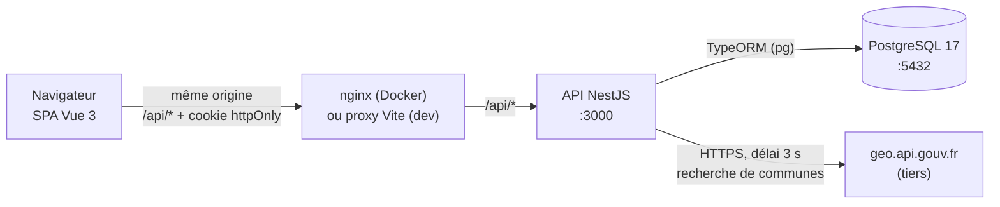

# Architecture

## Vue d'ensemble



Le navigateur ne parle qu'à **une seule origine** : nginx sert les fichiers Vue compilés et transmet
`/api/*` à NestJS (en développement, le proxy Vite fait la même chose). Aucun CORS n'est nécessaire et
le cookie de session peut rester en `SameSite=Strict`. Seul NestJS parle à PostgreSQL et à l'API
externe : l'application Vue ne reçoit jamais de secret.

## Choix techniques

| Besoin | Choix | Raison |
|---|---|---|
| API | NestJS 11, TypeScript 5.9, Node 22 LTS | Pile imposée ; modules, gardes et pipes correspondent bien à nos règles |
| Persistance | PostgreSQL 17 + TypeORM 0.3 (`@nestjs/typeorm`) | Intégration officielle Nest, entités + migrations versionnées, transactions avec verrou de ligne |
| Migrations | Migrations TypeORM, `synchronize: false` | Le schéma est relu en pull request et reproductible depuis une base vide |
| Validation | DTO `class-validator` + `ValidationPipe` global (`whitelist`, `forbidNonWhitelisted`) | Rejette les champs inconnus comme `role` ou `status` |
| Documentation API | `@nestjs/swagger` sur `/api/docs` + [contrats-api.md](contrats-api.md) | Contrat vivant des routes faites, contrat écrit pour tout le MVP |
| Mots de passe | Argon2id | Recommandation OWASP |
| Sessions | JWT dans `rth_session` (cookie httpOnly, SameSite=Strict, Secure en production), durée 2 h ; compte et `session_version` relus à chaque requête | Déconnexion locale par effacement du cookie ; suspension et toute révocation globale par incrément de version (règles métier §9) |
| En-têtes de sécurité | `helmet` | CSP, `X-Content-Type-Options`, etc. |
| Limitation de débit | `@nestjs/throttler` | Connexion, inscription, envoi de messages |
| Front | Vue 3.5 (`<script setup>`), Vue Router 4, Vite 7 | Pile imposée, compilation simple |
| État front | Pinia pour la session seulement, composables ailleurs | Évite un magasin global pour tout |
| Styles | CSS écrit à la main avec des variables de thème | Contrôle total du contraste, de la taille du texte et du focus |
| Tests API | Jest (unitaires) et Jest + Supertest sur une base `*_test` (bout en bout) | Les règles d'autorisation doivent être testées avec du vrai SQL |
| Tests front | Vitest + Vue Test Utils | Même outillage que Vite |
| Conteneurs | Docker Compose : `db`, `api`, `web` avec sondes de santé | Évaluation reproductible |

> Les versions sont les dernières de ces majeures. Des majeures plus récentes existent (NestJS 12,
> TypeORM 1.x, Vite 8) ; on reste sur celles dont la documentation est stable pour un projet d'une
> semaine.

## Organisation du code

```
api/src/
├── main.ts              démarrage
├── app.setup.ts         préfixe /api, ValidationPipe, filtre d'erreurs, helmet, Swagger
├── app.module.ts
├── config/              validation des variables d'environnement
├── common/              filtre d'exceptions, codes d'erreur (puis gardes en tâche 1)
├── database/            source de données, liste des entités, migrations
├── health/              GET /api/health
├── interests/           entité Interest + GET /api/interests
├── users/               entité User (tâche 1 : auth, rôles)
├── profiles/            entités Profile et ProfileInterest (tâche 1)
├── events/              entités Event et EventRegistration (tâche 2)
├── messaging/           entités Conversation et Message (tâche 3)
└── moderation/          routes, service transactionnel et entité ModerationAction (tâche 4)

web/src/
├── main.ts, App.vue     ossature : lien d'évitement, en-tête, <main>, pied de page
├── router/              routes et gardes de navigation
├── api/                 client fetch partagé (http.ts) + un fichier par module
├── views/               une vue par route
└── assets/main.css      variables de thème : texte 18 px, contraste AA, focus visible
```

Chaque module possède ses entités, ses DTO, son contrôleur et son service. Les règles qui traversent
plusieurs modules passent par des services exportés (la messagerie demandera aux événements si deux
membres partagent une inscription).

**Autorisation réutilisable** (mise en place en tâche 1) :

- `JwtAuthGuard` global : authentifie le cookie et relit le compte ; `@Public()` l'ignore.
- `@RequireAccess('session' | 'active' | 'approved' | 'organizer' | 'moderator')` : contrôle dans cet ordre des statuts de compte, du profil puis du rôle.
- `@Roles('organizer' | 'moderator')` : contrôle du rôle.
- `@CurrentUser()` : injecte le compte authentifié ; aucun service ne fait confiance à un
  identifiant venant du corps de la requête pour savoir « qui je suis ».
- La propriété d'une ressource est vérifiée dans le service, car elle demande de la charger.
- Les jetons expirent après 2 h sans renouvellement automatique. La déconnexion efface le cookie
  `rth_session` (`Path=/api`) ; une suspension incrémente `session_version`. Les anciennes sessions
  restent limitées à `/api/me` et `/api/auth/logout`; après réactivation, elles sont rejetées.
- Le contrat MVP expose la déconnexion de la session courante ; aucune route de déconnexion globale
  n'est définie. Une future opération de révocation globale devra incrémenter `session_version`.

## Parcours d'une fonctionnalité dans la pile

Exemple : s'inscrire à un événement.

| Couche | Élément |
|---|---|
| Vue | `EventDetailView.vue` → bouton « Je participe » → `api/events.ts#register(id)` |
| HTTP | `POST /api/events/:id/registration` avec le cookie de session |
| NestJS | `EventsController.register` → gardes (authentification, `@RequireAccess('approved')`) → `RegistrationsService.register(user, eventId)` |
| Validation | `ParseUUIDPipe` sur `:id` ; règles R-REG-2 dans le service |
| PostgreSQL | Transaction : `SELECT … FROM events WHERE id = $1 FOR UPDATE` → comptage des inscrits → `INSERT … ON CONFLICT (event_id, user_id) DO UPDATE` |
| Réponse | `201 { status, availablePlaces }` ou `409 EVENT_FULL`, affiché dans une zone de message |

## API tierce : recherche de communes

- **Fournisseur :** API Découpage administratif (`https://geo.api.gouv.fr`), service public français,
  gratuit, sans clé, usage raisonnable documenté.
- **Point d'entrée :** `GET /communes?nom={q}&fields=nom,code,codeDepartement,codesPostaux&boost=population&limit=8`.
- **Bénéfice :** les membres et les organisateurs choisissent une vraie commune au lieu de la taper,
  ce qui rend le filtre par ville et par département fiable.
- **Minimisation :** seul le texte saisi est envoyé, aucune donnée personnelle. On stocke la commune,
  le code postal, le département et le code INSEE — jamais de coordonnées.
- **Résilience :** délai de 3 secondes (`AbortController`), forme de la réponse validée, résultats
  mis en cache 10 minutes en mémoire (100 termes au maximum, éviction du moins récemment utilisé ;
  les échecs ne sont jamais mis en cache). En cas d'échec, l'API répond `503 CITY_LOOKUP_UNAVAILABLE`
  et le formulaire Vue bascule en saisie manuelle (ville + code postal) avec
  `location_verified = false`. L'inscription, l'édition du profil et la création d'événement ne
  dépendent jamais du service tiers.
- **Maîtrise de l'usage :** `GET /api/cities` est limité à 30 appels par tranche de 10 secondes et
  par compte connecté (`429 TOO_MANY_REQUESTS`). Le cache ne protège pas d'une rafale de termes
  différents, et le fournisseur limite à 10 requêtes par seconde pour notre unique adresse IP. La
  fenêtre est courte pour borner la rafale elle-même, non seulement le volume horaire. Cette limite
  borne un compte à la fois : si le trafic augmentait, il faudrait y ajouter un plafond global.

## Stratégie de tests

| Niveau | Outil | Exemples |
|---|---|---|
| Unitaire (API) | Jest | Le filtre d'erreurs masque les détails internes ; règles de capacité et d'éligibilité avec des dépôts simulés |
| Bout en bout (API) | Jest + Supertest + base `re_tired_hearts_test` | Anonyme → 401 ; membre → 403 sur la modération ; conversation d'autrui → 404 ; deux inscriptions simultanées → un seul succès |
| Composant (Vue) | Vitest + Vue Test Utils | États chargement / vide / erreur, messages de validation |
| Recette manuelle | `docs/security-review.md` (tâche 4) | Parcours au clavier seul, zoom 200 %, largeur mobile, session expirée |

La suite bout en bout réinitialise sa propre base (uniquement un nom finissant par `_test`) puis
rejoue les migrations : elle ne touche jamais aux données de démonstration.

## Décisions figées pour le MVP

1. Une seule origine (nginx ou proxy Vite), pas de CORS, session par cookie.
2. Un rôle par compte ; les rôles élevés ne s'obtiennent que par modération ou par le seed.
3. Deux statuts distincts : le compte (`active` / `suspended`) et le profil (`pending` / `approved` /
   `blocked`).
4. Localisation approximative = ville + département ; l'adresse exacte n'existe que sur un événement
   et seulement pour ses inscrits.
5. Capacité garantie par un verrou de ligne dans une transaction.
6. Une conversation est une paire ordonnée unique ; les modérateurs n'accèdent pas aux messages.
7. Chaque décision de modération est écrite dans `moderation_actions` dans la même transaction.

## Registre des risques

| # | Domaine | Risque | Probabilité | Impact | Réponse dans le MVP | Porteur |
|---|---|---|:-:|:-:|---|---|
| R1 | Vie privée | Données personnelles (e-mail, code postal, adresse exacte) exposées aux autres membres ou aux visiteurs | Moyenne | Fort | DTO séparés pour soi / les membres / la modération ; e-mail et code postal absents des réponses publiques ; adresse exacte réservée aux inscrits ; tests vérifiant l'absence des champs | Étudiant A |
| R2 | Vie privée | Accès au profil, aux inscriptions ou aux conversations d'autrui en changeant un identifiant | Forte | Fort | UUID ; routes « moi » pour ses propres données ; vérification de propriété dans les services ; `404` pour les non-participants ; un test par route | Étudiant B |
| R3 | Vie privée | Un modérateur lit les messages privés | Faible | Fort | Aucune route de modération sur la messagerie ; le journal d'audit ne stocke aucun contenu de message | Étudiant A |
| R4 | Usurpation | Faux profils, arnaques sentimentales visant ce public | Forte | Fort | Modération avant publication : tout nouveau profil est `pending` ; blocage et suspension ; aucun contact possible sans événement partagé | Étudiant A |
| R5 | Usurpation | Un membre s'attribue le rôle organisateur ou modérateur par une requête forgée | Moyenne | Fort | Aucun champ `role` ni `status` dans les DTO + `forbidNonWhitelisted` ; rôle relu en base ; modérateur uniquement par seed ou commande opérateur ; tests dédiés | Étudiant A |
| R6 | Usurpation | Vol de session, ou session réutilisée après une suspension | Moyenne | Fort | Cookie httpOnly + `SameSite=Strict`, durée 2 h, `session_version` vérifié à chaque requête, CSP via helmet | Étudiant A |
| R7 | Contacts non désirés | Membres sollicités par des inconnus, ou harcelés | Forte | Fort | Contact limité aux participants d'un même événement ou à l'organisateur ; option « je n'accepte pas les messages » ; limite de débit ; blocage et suspension par un modérateur | Étudiant B |
| R8 | Contacts non désirés | Le lieu de rendez-vous exact sert à retrouver quelqu'un | Faible | Fort | Adresse exacte réservée aux inscrits ; aucun profil ne porte d'adresse | Étudiant B |
| R9 | Modération | Abus de pouvoir ou décision non traçable | Faible | Moyen | Journal `moderation_actions` en ajout seul (modérateur, cible, date, motif) ; un modérateur ne peut pas en cibler un autre | Étudiant A |
| R10 | Modération | Contenu inapproprié dans une présentation, un événement ou un message | Moyenne | Moyen | Longueurs limitées, affichage en texte brut (jamais `v-html`), modération a posteriori par blocage ; pas de classification automatique (hors périmètre) | Étudiant C |
| R11 | Disponibilité | API de communes lente ou indisponible | Moyenne | Faible | Délai de 3 s, cache, bascule en saisie manuelle ; les parcours principaux n'en dépendent pas | Étudiant B |
| R12 | Disponibilité | L'API démarre avant PostgreSQL, ou une migration échoue le jour de la démo | Moyenne | Fort | Sonde de santé Compose + `depends_on: service_healthy` ; migrations jouées au démarrage et échec visible ; `db:reset` + seed répétés avant la soutenance | Étudiant B |
| R13 | Intégrité | Surréservation en cas d'inscriptions simultanées | Moyenne | Moyen | Verrou de ligne + contrainte unique ; test de concurrence | Étudiant B |
| R14 | Accessibilité | Des personnes de plus de 60 ans n'arrivent pas à remplir les formulaires | Moyenne | Fort | Texte de base à 18 px, libellés toujours visibles, erreurs à côté du champ et en résumé, cibles de 48 px, parcours testé au clavier | Étudiant C |
| R15 | Livraison | L'équipe manque de temps sur les fonctionnalités secondaires | Forte | Moyen | Périmètre figé dans `docs/equipe-et-perimetre.md` ; une tranche verticale par jour ; les « bonus » seulement après la tâche 5 | Toute l'équipe |
