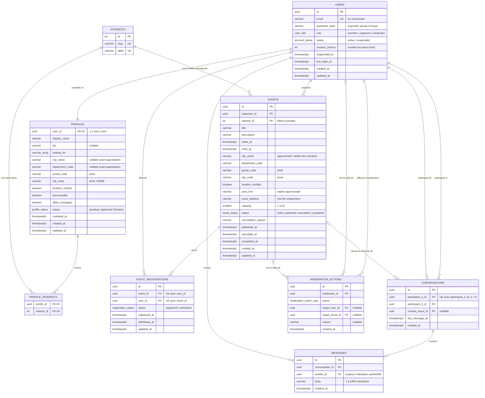

# Modèle de données

PostgreSQL fait foi. Le schéma n'est créé que par des **migrations versionnées** TypeORM
(`api/src/database/migrations/`) ; `synchronize` est désactivé. Les entités sont déclarées à côté de
leur module (`api/src/**/*.entity.ts`) et listées dans `api/src/database/entities.ts`.

Nommage des contraintes : `pk_<table>`, `fk_<table>_<colonne>`, `uq_<table>_<colonnes>`,
`chk_<table>_<règle>`, `idx_<table>_<colonnes>`.

## Diagramme

## Relations et cardinalités

| Relation | Cardinalité | Mise en œuvre | Suppression |
|---|---|---|---|
| User — Profile | 1 — 1 | `profiles.user_id` est à la fois PK et FK vers `users.id` | CASCADE |
| Profile — Interest | N — M | Table de jonction `profile_interests` (PK composite) | CASCADE (profil) / RESTRICT (intérêt) |
| User (organisateur) — Event | 1 — 0..N | `events.organizer_id` | RESTRICT |
| Interest — Event | 1 — 0..N | `events.interest_id`, **NOT NULL** : permet le filtre par centre d'intérêt | RESTRICT |
| Event — EventRegistration | 1 — 0..N | `event_registrations.event_id` | CASCADE (seuls les brouillons se suppriment) |
| User — EventRegistration | 1 — 0..N | `event_registrations.user_id` | CASCADE |
| User — Conversation | 2 participants par conversation | `participant_a_id`, `participant_b_id` | RESTRICT |
| Event — Conversation | 0..1 — 0..N | `conversations.context_event_id` : pourquoi le contact était autorisé | SET NULL |
| Conversation — Message | 1 — 0..N | `messages.conversation_id` | CASCADE |
| User — Message | 1 — 0..N | `messages.sender_id` | RESTRICT |
| User (modérateur) — ModerationAction | 1 — 0..N | `moderation_actions.moderator_id` | RESTRICT |
| User / Event (cible) — ModerationAction | 0..1 — 0..N | `target_user_id` **ou** `target_event_id`, jamais les deux | RESTRICT |

Aucun compte n'est supprimé dans le MVP (on suspend à la place) : le `RESTRICT` protège l'historique
des événements, des messages et des décisions de modération.

## Choix de représentation

| Sujet | Décision |
|---|---|
| Identifiants | `uuid` (`gen_random_uuid()`) pour toute ressource exposée : non devinable dans une URL. `interests.id` est un entier (donnée de référence). |
| Rôles | Une colonne `users.role` de type énuméré ; pas de table de rôles (trois rôles fixes). |
| Statuts | Types énumérés PostgreSQL : `account_status`, `profile_status`, `event_status`, `registration_status`, `moderation_action_type`. |
| Centres d'intérêt | Table de référence alimentée par une migration ; les membres choisissent dedans, ils n'en créent pas. |
| Localisation approximative | Colonnes dénormalisées sur `profiles` et `events` ; pas de coordonnées, pas de table de villes. |
| Propriété d'un événement | `events.organizer_id`, vérifiée dans le service à chaque écriture. |
| Paire de conversation | Paire ordonnée (`a < b`) + contrainte unique : une seule conversation par duo, quel que soit l'initiateur. |
| États de modération | Colonnes de statut sur la cible + journal `moderation_actions` écrit dans la **même transaction**. |
| Dates | `timestamptz` partout, stocké en UTC, affiché en Europe/Paris. |

## Contraintes vérifiées par PostgreSQL

| Contrainte | Règle |
|---|---|
| `uq_users_email`, `chk_users_email_lowercase` | Un compte par e-mail, stocké en minuscules |
| `chk_users_suspension` | `suspended_at` renseigné si et seulement si le compte est suspendu |
| `chk_profiles_display_name_length` | 2 à 40 caractères après nettoyage |
| `chk_profiles_looking_for` | Valeurs limitées à `friendship`, `companionship`, `romance`, `activities` |
| `chk_profiles_postal_code` | Cinq chiffres si renseigné |
| `chk_profiles_location_when_approved` | Un profil approuvé a toujours une ville et un département |
| `chk_events_dates` | `ends_at > starts_at` |
| `chk_events_capacity` | `capacity` entre 1 et 50 |
| `chk_events_cancellation` | `cancelled_at` et `cancellation_reason` renseignés si et seulement si l'événement est annulé |
| `chk_events_completion` | `completed_at` renseigné si et seulement si l'événement est terminé |
| `uq_event_registrations_event_user` | Pas d'inscription en double pour un même membre et un même événement |
| `chk_event_registrations_withdrawal` | `withdrawn_at` renseigné si et seulement si l'inscription est retirée |
| `chk_conversations_distinct_ordered` | `participant_a_id < participant_b_id` : deux personnes distinctes, ordre canonique |
| `uq_conversations_pair` | Une seule conversation par duo |
| `chk_messages_body_length` | Entre 1 et 1000 caractères après nettoyage des espaces |
| `chk_moderation_actions_single_target` | Exactement une cible : un compte **ou** un événement |

Les règles qui dépendent d'autres lignes (capacité, « un organisateur ne s'inscrit pas à son propre
événement », éligibilité d'une conversation) sont appliquées dans les services NestJS, à l'intérieur
de transactions — voir [règles métier](regles-metier.md).

## Migrations

| Migration | Contenu |
|---|---|
| `…-InitialSchema` | Types énumérés, les neuf tables, clés, contraintes et index |
| `…-SeedInterests` | Liste de référence des centres d'intérêt |

On ne modifie jamais une migration déjà fusionnée dans `main` : on en ajoute une nouvelle. Chaque
migration a un `down()` qui fonctionne. Les données de démonstration (comptes, événements, messages)
ne sont **pas** une migration : elles viennent du script de seed (tâche 5).
