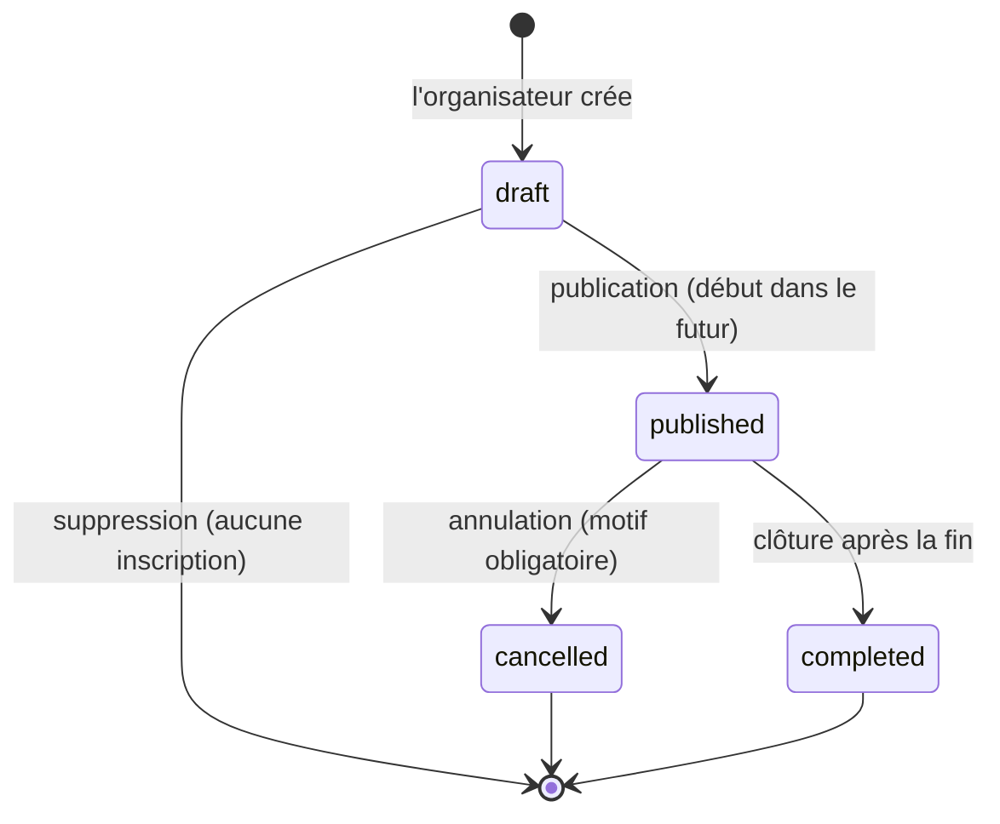

# Règles métier

Ces règles sont figées pour le MVP. Elles sont appliquées **par l'API** (gardes et services),
appuyées par des contraintes PostgreSQL quand c'est possible, et seulement *reflétées* par
l'interface Vue : masquer un bouton n'est jamais une protection. Les identifiants `R-…` sont repris
dans les commentaires du code, les tests et [les contrats d'API](contrats-api.md).

## 1. Rôles

| Action | membre | organisateur | modérateur |
|---|:-:|:-:|:-:|
| Profil, découverte, événements, inscriptions, messages (selon les statuts) | ✅ | ✅ | ✅ |
| Créer, modifier, publier, annuler, clôturer, supprimer **ses propres** événements | — | ✅ | — |
| S'inscrire à un événement organisé par **quelqu'un d'autre** | ✅ | ✅ | ✅ |
| S'inscrire à **son propre** événement | — | ❌ | — |
| Back-office de modération et journal d'audit | — | — | ✅ |
| Lire les conversations ou les messages d'autrui | ❌ | ❌ | ❌ |

- **R-ROLE-1** Tout nouveau compte est créé avec le rôle `member`. Le DTO d'inscription n'a pas de
  champ `role` et les champs inconnus sont rejetés (`forbidNonWhitelisted`) : envoyer
  `{"role":"moderator"}` renvoie `400 VALIDATION_FAILED`.
- **R-ROLE-2** Le rôle `organizer` est attribué ou retiré uniquement par un modérateur depuis le
  back-office (action tracée dans `moderation_actions`) ou par le seed.
- **R-ROLE-3** Le rôle `moderator` est attribué uniquement par le seed ou par une commande opérateur
  nécessitant un accès direct à la base. **Aucune route HTTP** ne crée un modérateur.
- **R-ROLE-4** Un compte a exactement un rôle. Un organisateur garde tous les droits d'un membre. Un
  modérateur garde les droits d'un membre mais **ne peut pas créer d'événement** : modérer n'est pas
  organiser.
- **R-ROLE-5** Un modérateur ne peut pas se modérer lui-même ni modérer un autre modérateur (évite
  les blocages mutuels) ; cela passe par la commande opérateur.
- **R-ROLE-6** Le rôle et les statuts ne sont jamais lus dans le jeton de session : ils sont relus
  dans PostgreSQL à chaque requête protégée, donc un changement s'applique immédiatement.

## 2. Statuts de compte et de profil

Deux statuts indépendants : `users.status` (`active` par défaut, ou `suspended`) et `profiles.status`
(`pending` par défaut, `approved` ou `blocked`).

| Situation | Se connecter | Voir son compte | Éditer son profil | Voir les événements | Découvrir les profils | Créer un événement | S'inscrire | Messagerie |
|---|:-:|:-:|:-:|:-:|:-:|:-:|:-:|:-:|
| actif + `pending` | ✅ | ✅ | ✅ | ✅ | ❌ | ❌ | ❌ | ❌ |
| actif + `approved` | ✅ | ✅ | ✅ | ✅ | ✅ | organisateur | ✅ | ✅ (voir §7) |
| actif + `blocked` | ✅ | ✅ | ❌ (lecture seule) | ❌ | ❌ | ❌ | ❌ | ❌ |
| `suspended` | ❌ `403 ACCOUNT_SUSPENDED` | ✅ compte et déconnexion via session existante | ❌ | ❌ | ❌ | ❌ | ❌ | ❌ |

- **R-STATUS-1** La suspension incrémente `session_version`. Après authentification, le garde global
  relit le compte en base à chaque requête : les sessions déjà ouvertes restent utilisables
  uniquement pour `GET /api/me` et `POST /api/auth/logout` (méthode et chemin exacts); toute autre
  route protégée répond `403 ACCOUNT_SUSPENDED`. Une nouvelle connexion au compte suspendu répond
  également `403 ACCOUNT_SUSPENDED`.
- **R-STATUS-2** Un profil bloqué est invisible partout (découverte, fiche profil, liste de
  participants, conversations des autres affichent « Membre indisponible »). Le garde global refuse
  également toute autre route protégée avec `403 PROFILE_BLOCKED`. Le membre garde l'accès à
  `GET /api/me`, à la lecture de son propre profil (`GET /api/me/profile`) et peut se déconnecter ;
  son profil reste en lecture seule.
- **R-STATUS-3** Les statuts ne changent **que** par une route de modération (ou par le seed). Aucune
  route membre n'accepte un champ `status`.
- **R-STATUS-4** Bloquer un profil ou suspendre un compte retire automatiquement ses inscriptions
  aux sorties à venir et libère les places. Suspendre un organisateur n'annule pas ses événements :
  le modérateur les annule explicitement pour que chaque décision soit tracée.
- **R-STATUS-5** `pending` et `blocked` sont des statuts de **profil**, pas de compte. Un profil
  `pending` peut consulter les événements et modifier son profil, mais ne peut accéder aux fonctions
  réservées aux profils approuvés (découverte, inscription et création d'événement). Un profil
  `blocked` conserve uniquement la lecture de son compte et de son profil et la déconnexion.
  `users.status` ne comporte que `active` et `suspended`.

## 3. Profil et confidentialité

| Donnée | Obligatoire | Visible par | Remarque |
|---|---|---|---|
| E-mail | à l'inscription | **propriétaire, modérateurs** | Unique, en minuscules ; jamais montré aux membres |
| Mot de passe | à l'inscription (12 car. min) | **personne** | Haché en Argon2id, jamais renvoyé |
| Nom affiché | à l'inscription (2–40 car.) | membres | Prénom ou pseudo ; l'interface déconseille le nom complet |
| Présentation | facultative (500 car. max) | membres | Texte brut, affiché échappé |
| Recherche | facultative (`amitié`, `compagnie`, `relation`, `activités`) | membres | Choix multiple |
| Centres d'intérêt | 1 à 10 requis **pour l'approbation** | membres | Choisis dans la liste de référence |
| Ville + département | requis **pour l'approbation** | membres | Localisation approximative, ex. « Villeurbanne (69) » |
| Code postal, code INSEE | facultatifs | **propriétaire, modérateurs** | Servent au filtrage, jamais affichés aux membres |
| `discoverable` | `true` par défaut | propriétaire | `false` retire le profil de la découverte |
| `allow_messages` | `true` par défaut | propriétaire (les membres voient seulement « accepte les messages ») | `false` refuse les nouvelles conversations et les nouveaux messages |
| Rôle | — | badge « Organisateur » ; le rôle modérateur n'est pas affiché | |
| Membre depuis | automatique | membres | Mois et année seulement |

- **R-PROF-1** Le profil est créé automatiquement à l'inscription, au statut `pending`. Il n'est
  jamais visible dans la découverte avant approbation.
- **R-PROF-2** Un modérateur ne peut approuver qu'un profil **complet** : nom affiché, ville,
  département, au moins un centre d'intérêt. La base refuse aussi un profil approuvé sans ville.
- **R-PROF-3** La découverte liste les profils `approved` **et** `discoverable` **et** dont le compte
  est `active`, en excluant le visiteur lui-même. Seul un membre actif et approuvé peut l'utiliser.
- **R-PROF-4** Consulter un profil suit la même règle. Tous les autres cas (en attente, bloqué,
  suspendu, non visible, inconnu) renvoient **le même** `404 PROFILE_UNAVAILABLE` : la réponse ne
  révèle pas si le compte existe.
- **R-PROF-5** Chaque membre corrige ou retire ses informations lui-même : tous les champs
  facultatifs peuvent être vidés. Les modifications d'un profil approuvé restent en ligne
  (modération a posteriori par blocage). Exception : la ville et le département se modifient mais ne
  se retirent pas tant que le profil est `approved` (R-PROF-2) ; la tentative répond `400` et ne
  change jamais le statut (R-STATUS-3). Le changement d'e-mail et la suppression de compte ne sont
  pas dans le MVP : ils sont traités manuellement (limite documentée).
- **R-PROF-6** Un visiteur anonyme ne voit aucune donnée de membre : seulement l'accueil, les centres
  d'intérêt, les mentions légales, la page vie privée, la connexion et l'inscription.

## 4. Localisation approximative

- **R-LOC-1** La localisation est stockée comme ville, département, code postal et code INSEE —
  jamais de coordonnées, jamais d'adresse postale pour un profil.
- **R-LOC-2** Les membres voient uniquement « Ville (département) ». Le filtrage utilise le
  département ou le code de la commune.
- **R-LOC-3** La ville est choisie via la recherche de communes (API externe, tâche 5). Si le service
  est lent (> 3 s) ou indisponible, le formulaire bascule en **saisie manuelle** (ville et département,
  code postal facultatif ; chacun validé par son format) et la localisation est enregistrée avec
  `location_verified = false`.
- **R-LOC-4** Un événement a un **repère approximatif** public (ex. « près du parc de la Tête d'Or »)
  et une **adresse exacte** privée. L'adresse exacte n'est renvoyée qu'à l'organisateur, aux membres
  inscrits (`registered`) et aux modérateurs.

## 5. Événements

| Statut | Qui le voit | Dans la découverte | Accepte des inscriptions |
|---|---|:-:|:-:|
| `draft` | organisateur, modérateurs | ❌ | ❌ |
| `published`, à venir | membres actifs (profil non bloqué) | ✅ | ✅ s'il reste des places |
| `published`, passé | idem, affiché « Terminé » | ❌ | ❌ |
| `cancelled` | organisateur, inscrits, modérateurs | ❌ | ❌ |
| `completed` | organisateur, inscrits, modérateurs | ❌ | ❌ |

- **R-EVT-1** Chaque événement a exactement un **centre d'intérêt principal** (`events.interest_id`,
  clé étrangère) qui sert au filtrage, et un organisateur.
- **R-EVT-2** Créer un événement exige le rôle `organizer`, un compte actif et un profil approuvé.
- **R-EVT-3** La capacité est un entier **entre 1 et 50** (participants, organisateur non compris).
  Elle ne peut pas descendre sous le nombre d'inscrits actuels (`409 CAPACITY_BELOW_REGISTRATIONS`).
- **R-EVT-4** `ends_at > starts_at`. Un brouillon ne se publie que si `starts_at` est dans le futur.
- **R-EVT-5** Les brouillons et les événements publiés pas encore commencés sont modifiables par leur
  organisateur. Tant qu'un événement publié a des inscrits, la date, le lieu et le centre d'intérêt
  ne peuvent plus changer. Les événements annulés ou terminés sont en lecture seule.
- **R-EVT-6** Seul un brouillon sans inscription peut être supprimé. Un événement publié s'annule, il
  ne se supprime pas : l'historique est conservé.
- **R-EVT-7** Un organisateur ne gère que **ses propres** événements (`403 NOT_EVENT_OWNER`). Un
  modérateur peut consulter tout événement et annuler un événement publié ; il ne peut ni le
  modifier, ni le publier, ni le supprimer.
- **R-EVT-8** Les événements annulés ou terminés restent accessibles à leurs participants, avec un
  bandeau de statut clair et le motif d'annulation.

## 6. Inscriptions et capacité

- **R-REG-1** Une seule ligne par (événement, membre) : `UNIQUE (event_id, user_id)`. Le statut est
  `registered` ou `withdrawn`. Se désinscrire **met à jour** la ligne ; se réinscrire la réactive.
- **R-REG-2** Un membre peut s'inscrire si : compte actif, profil approuvé, événement `published`,
  début dans le futur, il n'est pas l'organisateur, il reste des places, il n'est pas déjà inscrit.
- **R-REG-3** Seules les lignes `registered` comptent :
  `places disponibles = capacité − nombre d'inscrits`.
- **R-REG-4** L'inscription s'exécute dans une transaction qui **verrouille la ligne de l'événement**
  (`SELECT … FOR UPDATE`), compte les inscrits, puis insère ou réactive. Deux demandes simultanées
  pour la dernière place sont sérialisées : l'une réussit, l'autre reçoit `409 EVENT_FULL`.
- **R-REG-5** Un membre peut se désinscrire jusqu'au début de l'événement ; la place est libérée
  immédiatement, même si son profil n'est plus approuvé tant que son compte est actif.
- **R-REG-6** L'organisateur, les modérateurs et les inscrits voient la liste des participants (noms
  affichés des membres actifs et approuvés uniquement).

## 7. Conversations et messages

- **R-MSG-1 (éligibilité)** A peut **démarrer** une conversation avec B si :
  - A et B ont tous les deux une inscription `registered` au même événement, **ou**
  - A est inscrit (`registered`) à un événement organisé par B, ou l'inverse ;
  - **et** les deux comptes sont actifs, les deux profils approuvés, et les deux acceptent les
    messages privés.
  Une inscription retirée ne donne aucun droit de contact. Un brouillon non plus.
- **R-MSG-2** Une conversation a exactement deux participants distincts, stockés comme paire ordonnée
  (`participant_a_id < participant_b_id`) avec une contrainte unique. Démarrer une conversation qui
  existe déjà renvoie l'existante (`200`), quel que soit l'initiateur.
- **R-MSG-3** Une fois créée, la conversation continue même après la fin de l'événement ou une
  désinscription, tant que les deux comptes restent autorisés à communiquer. Sinon l'envoi est refusé
  (`409 RECIPIENT_UNAVAILABLE` ou `409 MESSAGING_DISABLED`).
- **R-MSG-4** Une conversation n'est visible que de ses deux participants. Pour toute autre personne,
  **y compris un modérateur**, chaque lecture et chaque écriture répond `404 CONVERSATION_NOT_FOUND`.
- **R-MSG-5** L'expéditeur est toujours l'utilisateur authentifié ; le corps de la requête ne contient
  aucun identifiant d'expéditeur.
- **R-MSG-6** Un message est du texte brut, de **1 à 1000 caractères après nettoyage des espaces**. Il
  est stocké nettoyé et affiché par interpolation de texte uniquement (jamais `v-html`). La base
  répète la règle.
- **R-MSG-7** Un participant dont le compte est actif et le profil non bloqué peut relire
  l'historique. Si l'autre devient indisponible, l'historique reste lisible, l'autre personne est
  affichée « Membre indisponible » et le formulaire d'envoi est désactivé avec une explication.
- **R-MSG-8** L'envoi est limité à 30 messages par tranche de 10 minutes et par compte
  (`429 TOO_MANY_REQUESTS`).

## 8. Modération

| Action | Transition | Motif |
|---|---|---|
| `approve_profile` | profil `pending` → `approved` (profil complet) | facultatif |
| `block_profile` | profil `pending` ou `approved` → `blocked` | **obligatoire** |
| `unblock_profile` | profil `blocked` → `approved` | facultatif |
| `suspend_account` | compte `active` → `suspended` (+ `session_version` incrémenté) | **obligatoire** |
| `reactivate_account` | compte `suspended` → `active` | facultatif |
| `cancel_event` | événement `published` → `cancelled` | **obligatoire** |
| `grant_organizer` / `revoke_organizer` | rôle `member` ↔ `organizer` | facultatif |

- **R-MOD-1** Chaque action écrit une ligne dans `moderation_actions` **dans la même transaction** que
  le changement d'état : modérateur, action, cible, motif éventuel, date. Le journal ne contient
  jamais de mot de passe ni de contenu de message. Il est en ajout seul (aucune route de
  modification ou de suppression).
- **R-MOD-2** Un modérateur voit : e-mail, rôle, statuts, champs du profil, détails des événements
  (adresse comprise) et le journal d'audit. Jamais les conversations ni les messages.
- **R-MOD-3** Les actions destructrices (bloquer, suspendre, annuler) exigent une confirmation
  explicite dans l'interface, qui nomme la cible.
- **R-MOD-4** Réactiver un compte suspendu ne restaure **pas** les inscriptions que la suspension a
  libérées : les places ont pu être reprises entre-temps. Le membre doit se réinscrire.
- **R-MOD-5** Ouvert (question à l'équipe) : rétrograder un organisateur (`organizer` → `member`)
  laisse ses sorties publiées sans personne pour les gérer. Aujourd'hui rien n'est fait ; à trancher :
  bloquer la rétrogradation tant qu'il a des sorties à venir, ou les annuler automatiquement.

## 9. Sessions et mots de passe

- **R-AUTH-1** Mot de passe de 12 à 128 caractères, haché en Argon2id ; jamais journalisé ni renvoyé.
- **R-AUTH-2** La connexion renvoie un JWT signé dans un cookie `httpOnly`, `SameSite=Strict`
  (`Secure` en production), valable **2 heures**. Le jeton ne contient que l'identifiant du compte et
  `session_version`.
- **R-AUTH-3** À chaque requête protégée, la garde relit le compte dans PostgreSQL et rejette le jeton
  si le compte n'existe plus ou si `session_version` a changé (`401 SESSION_EXPIRED`). Exception :
  un compte suspendu conserve l'accès de session uniquement pour `GET /api/me` et
  `POST /api/auth/logout`; toutes ses autres routes restent interdites.
- **R-AUTH-4** La déconnexion efface le cookie. « Se déconnecter partout » et la suspension
  incrémentent `session_version`; après réactivation, les anciens jetons sont rejetés.
- **R-AUTH-5** Un e-mail inconnu et un mot de passe faux produisent le **même** `401
  INVALID_CREDENTIALS`. La connexion est limitée à 5 tentatives par quart d'heure.
- **R-AUTH-6** Une session expirée renvoie vers la page de connexion avec le message « Votre session a
  expiré, merci de vous reconnecter », puis ramène à la page demandée.
